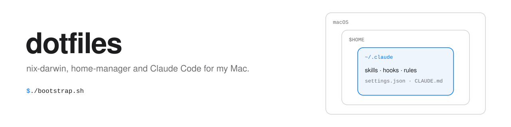

<picture>
  <source media="(prefers-color-scheme: dark)" srcset="docs/assets/banner-dark.svg">
  
</picture>

One repo sets up my personal Mac with
[nix-darwin](https://github.com/nix-darwin/nix-darwin), which manages macOS
settings and apps, and
[home-manager](https://github.com/nix-community/home-manager), which manages
the files in my home folder. Copy whatever helps, but I do not take
contributions.

## Set up the Mac

```sh
git clone https://github.com/davner/dotfiles.git
cd dotfiles
./bootstrap.sh
```

On a Mac without git, the clone first asks you to install the Xcode Command
Line Tools.

| Command | When | sudo |
| --- | --- | --- |
| `./bootstrap.sh` | Once, on a fresh install | yes |
| `./rebuild.sh` | After changing this repo | yes |
| `./rebuild.sh --build` | Check a change builds, without applying it | no |
| `./test.sh` | Before committing | no |

## What you get

- Apps and CLI tools: WezTerm, Claude Code, ripgrep, fd, fzf, jq, lazygit,
  neovim and uv.
- zsh with a starship prompt, direnv and short aliases.
- macOS settings: dark mode, a Dock that hides, fast key repeat.
- Claude Code skills for a workflow from idea to merged work, and the hooks
  below.

[What you get](docs/installed.md) lists every package, app and setting.

## Hooks

Hooks run on their own, in every repo, once the Mac is set up.

| Hook | When | What it does | Per-repo switch |
| --- | --- | --- | --- |
| `guard-bash.sh` | Before every shell command | Blocks risky git, a push or PR the repo has not allowed, and commit messages that credit an AI | None. To allow more: `cc-push on` for a plain push, `git config --local claude.allowPrs true` for PRs, and `git config --local claude.allowForcePush true` plus `cc-push on` for `--force-with-lease` |
| `skill-gate.sh` | Before Skill, Write, Edit, MultiEdit and Bash | Blocks a TypeScript write until the agent has loaded `typescript-style-guide` | None |
| `comment-audit.sh` | After every file write | Flags code comments that tell history or refer to the session | None |
| `ruff-after-edit.sh` | After a write to a `.py` or `.pyi` file | Runs `ruff check --fix` and `ruff format` on that file, then reports the lint errors left | `git config --local claude.ruff false` |
| `python-stop-check.sh` | When Claude stops | Checks the changed Python files with ruff and ty without changing them, and flags a blanket `# noqa` or `# type: ignore` | `git config --local claude.ruff false` and `git config --local claude.ty false` |
| `session-name.sh` | Session start | Names the session after its repo | None |
| impeccable's `hook` | Session start, after Edit or Write, and on stop | Checks UI files for design anti-patterns | `/impeccable hooks off` (writes `.impeccable/config.json`; keep it out of commits in a shared repo) |
| `statusline.sh` (status line) | Always | Shows model, context used and rate limits | None |

The two Python hooks run only where the repo has ruff or ty config. Set the
switch to `true` to turn one on without config, for example
`git config --local claude.ruff true`. `claude.ruff` controls ruff in both
hooks; ty in the stop check follows `claude.ty` alone.

[Claude Code setup](docs/claude-code.md#hooks) has the details of each hook.

## Everyday commands

| Command | What it does |
| --- | --- |
| `cc` | Starts Claude Code with permission prompts skipped and remote control on, the session named after the repo |
| `cc-flow` | Prints the Claude workflow as a table: which skill to run at each step |
| `cc-push` | Lets agents run a plain `git push` in this repo, or stops them |

## Docs

- [The Claude workflow](docs/workflow.md): from an idea to merged work, one
  skill per step.
- [Claude Code setup](docs/claude-code.md): every skill, hook and rule.
- [What you get](docs/installed.md): packages, apps, shell setup and macOS
  settings.
- [Troubleshooting](docs/troubleshooting.md): error messages and their fixes.
- [All docs](docs/README.md): the index, with the repo layout, tests and CI,
  and every decision record.

Notes for agents working on this repo are in [AGENTS.md](AGENTS.md).
