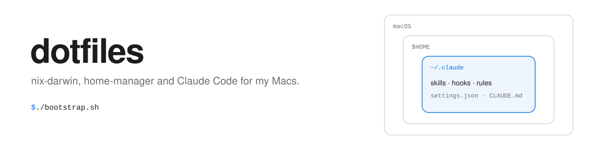
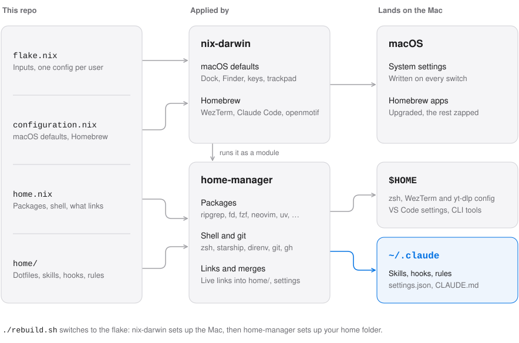

<picture>
  <source media="(prefers-color-scheme: dark)" srcset="docs/assets/banner-dark.svg">
  
</picture>

One repo sets up my Macs: macOS settings, Homebrew apps, CLI tools, zsh, and a
Claude Code setup of global rules, skills and hooks. It runs on
[nix-darwin](https://github.com/nix-darwin/nix-darwin) and
[home-manager](https://github.com/nix-community/home-manager). One branch
serves every machine, and the config is keyed by macOS username.

This is my personal setup. Copy whatever helps, but I do not take
contributions.

## Set up a Mac

```sh
git clone https://github.com/davner/dotfiles.git
cd dotfiles
./bootstrap.sh
```

On a Mac without git, the clone first asks you to install the Xcode Command
Line Tools.

| Command | When | sudo |
| --- | --- | --- |
| `./bootstrap.sh` | Once, on a new Mac | yes |
| `./rebuild.sh` | After changing this repo | yes |
| `./rebuild.sh --build` | Check a change builds, without applying it | no |
| `./test.sh` | Before committing | no |

## What you get

| Part | What it brings |
| --- | --- |
| Apps and tools | WezTerm, Claude Code, and CLI tools such as ripgrep, fd, fzf, jq, lazygit, neovim and uv |
| Shell | zsh with a starship prompt, direnv, and short aliases such as `add`, `m` and `cc` |
| macOS settings | Dark mode, a Dock that hides, Finder in column view, fast key repeat and hot corners |
| Claude Code | Skills for a workflow from idea to merged work, and hooks that block risky git and commit lines that credit an AI |

Every package, app and setting is listed in [What you get](docs/installed.md).

## How it fits together

<picture>
  <source media="(prefers-color-scheme: dark)" srcset="docs/assets/architecture-dark.svg">
  
</picture>

Files under `home/` are linked into `$HOME`, so an edit to one takes effect at
once. Adding or removing a linked file needs `./rebuild.sh`.

## Usernames

`flake.nix` maps each macOS username to what differs per machine: the git
address and the platform. `./users.sh list` prints them, and `./bootstrap.sh`
offers to add a missing one. Each username builds as `#<username>`.

Dots become dashes because `darwin-rebuild` splits `--flake …#attr` on `.`
([ADR 0005](docs/adr/0005-dots-become-dashes-in-flake-attributes.md)).

## Everyday commands

| Command | What it does |
| --- | --- |
| `cc` | Starts Claude Code with permission prompts skipped and remote control on, the session named after the repo |
| `cc-flow` | Prints the Claude workflow as a table: which skill to run at each step |
| `cc-push` | Lets agents run a plain `git push` in this repo, or stops them |
| `./test.sh --fast` | Runs the tests without the Nix evaluations |
| `./users.sh list` | Lists the configured usernames |

## Docs

- [The Claude workflow](docs/workflow.md): from an idea to merged work, one
  skill per step, or `/autopilot` with nobody watching.
- [Claude Code setup](docs/claude-code.md): every skill, hook and rule.
- [What you get](docs/installed.md): packages, apps, shell setup and macOS
  settings.
- [Troubleshooting](docs/troubleshooting.md): error messages and their fixes.
- [All docs](docs/README.md): the index, with the repo layout, tests and CI,
  and every decision record.

Notes for agents working on this repo are in [AGENTS.md](AGENTS.md), including
[how the skills get installed](AGENTS.md#installing-the-skills).
