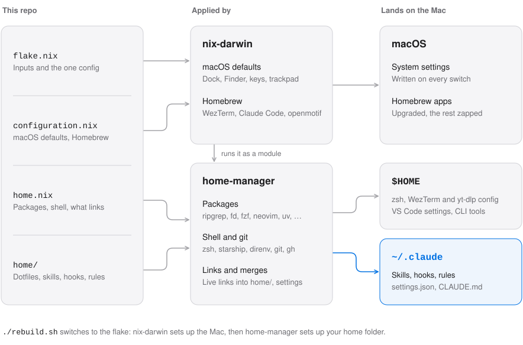

# Docs

Every page in this folder, one line each, then where things live in the repo.

## Guides and reference

| Page | What it covers |
| --- | --- |
| [The Claude workflow](workflow.md) | From an idea to merged work, one skill per step, and what `/autopilot` does with nobody watching |
| [Claude Code setup](claude-code.md) | Every skill, third-party skill, hook and rule, and how the hooks read a command |
| [What you get](installed.md) | Every package, app, alias, shell setting and macOS setting a rebuild installs |
| [Troubleshooting](troubleshooting.md) | Error messages from setup and rebuilds, and their fixes |

## Decisions (ADRs)

An ADR (architecture decision record) says why one thing is the way it is.
Read the one that names a thing before changing it.

| ADR | Decision |
| --- | --- |
| [0001](adr/0001-homebrew-cleanup-zap.md) | Homebrew cleanup is `zap`: anything not declared is removed |
| [0002](adr/0002-homebrew-upgrade-on-activation.md) | Homebrew upgrades what is installed on every rebuild |
| [0006](adr/0006-home-manager-backups.md) | home-manager backs up a clashing file instead of overwriting it |
| [0007](adr/0007-claude-settings-merge-not-link.md) | Claude settings are merged into `~/.claude/settings.json`, not linked |
| [0009](adr/0009-third-party-skills-are-pinned-flake-inputs.md) | Third-party skills are pinned flake inputs |
| [0010](adr/0010-vscode-settings-merge-and-add-only-extensions.md) | VS Code settings are merged, and extensions are only ever added |
| [0011](adr/0011-history-is-the-merged-pr-list.md) | History is the merged PR list, not a `CHANGELOG.md` |

## Research

| Note | Question |
| --- | --- |
| [Agent decision confidence](research/agent-decision-confidence.md) | When an unattended agent should park a design decision for a human |
| [Agent retry limits](research/agent-retry-limits.md) | How many times an unattended agent should try to fix a failing check |
| [GitHub issues, boards and labels](research/github-issues-boards-labels.md) | How maintainers use GitHub Issues, boards and labels, and what this repo should change |
| [Agent GitHub credentials](research/agent-github-credentials.md) | How to let agents open PRs, merge and move board items only on chosen repos |

## For agents

| Page | What it covers |
| --- | --- |
| [Domain docs](agents/domain.md) | Where the glossary and ADRs live, and how skills read them |
| [Issue tracker](agents/issue-tracker.md) | How specs, tickets and the TODO list are kept for this repo |

The images on these pages and the social preview are in [`assets/`](assets/),
each with a light and a dark version.

## What lives where

<picture>
  <source media="(prefers-color-scheme: dark)" srcset="assets/architecture-dark.svg">
  
</picture>

Files under `home/` are linked into `$HOME`, so an edit to one takes effect at
once. Adding or removing a linked file needs `./rebuild.sh`.

| Path | Holds |
| --- | --- |
| `flake.nix`, `configuration.nix`, `home.nix` | Inputs and the one configuration, `#danavner`; macOS and Homebrew; packages, zsh, and which files get linked |
| [`AGENTS.md`](../AGENTS.md) (`CLAUDE.md` links to it) | Notes for agents working on this repo |
| `docs/` | These pages, the ADRs and the research notes |
| `home/AGENTS.md` | Global agent rules, linked to `~/.claude/CLAUDE.md`, Codex and opencode |
| `home/.claude/skills/` | The skills, each folder linked into `~/.claude/skills/` |
| `home/.claude/rules/` | Path-scoped rules, each file linked into `~/.claude/rules/` |
| `home/.claude/hooks/` | Everything `settings.base.json` runs, hooks and status line, plus the helpers they share, each file linked into `~/.claude/hooks/` |
| `home/.claude/settings.base.json`, `local-skills.sh` | Run by every rebuild, not linked: the settings merged into `~/.claude/settings.json`, and the script that puts back `impeccable` |
| `home/vscode/` | VS Code: settings and keybindings merged into the user folder, and each profile's extensions installed when missing |
| `home/json-merge.sh` | Run by every rebuild, not linked: merges a base JSON file into a live one an app also writes, for Claude's and VS Code's settings |
| `home/.config/zsh/functions.zsh` | Shell functions: `cc`, `cc-push` and `cc-flow` |
| `tests/` | The test suite, one file per tested module |
| `preview-docs.sh` | Screenshots Markdown as GitHub renders it, light and dark, to check a docs change before pushing |

## Tests and CI

`./test.sh` runs every file in `tests/`, one per tested module, with no sudo and no
writes outside a temp folder. `./test.sh NAME` runs only `tests/NAME.sh`,
`--fast` skips the Nix evaluations, and `nix develop --command ./test.sh` adds
the linters, plus the ruff and ty the Python hook tests run.

CI runs the fast suite on every push, and the full suite plus a real build
every Monday. When the flake inputs move, a stock action keeps them in one
`flake-update` PR, rebuilt from `main` each week, that merges itself once the
full suite and the build pass on it and the push tests pass. If
`main` moves after the push, the PR waits for the next run to rebuild it, and
its merge starts no workflow on `main`.
