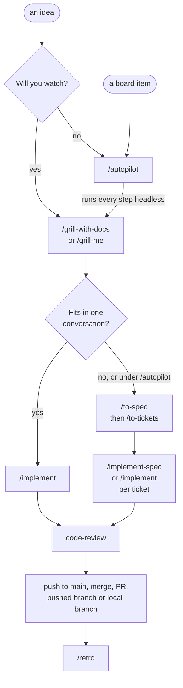

# The Claude workflow

From an idea to merged work, one skill per step, with you at the keyboard or
with `/autopilot` running it alone. In a shell, `cc-flow` prints the steps as a
short table.

## Once per repo

Run `/setup-dan-skills` once in each repo. It asks up to eight questions and
saves the answers, so the other skills never ask again. Every repo gets five:
whether the repo is shared with a team, the tracker (GitHub, Shortcut or Jira),
where specs and tickets go, the glossary path, and the ADR folder. A GitHub
tracker adds three: whether agents open PRs, whether they merge their own, and
whether the repo ships releases.

In a shared repo the glossary and ADRs are committed for everyone, and the
tracker file stays in `~/.claude/repos/<repo>/`, out of the repo. GitHub is
offered only for a repo nobody else commits to. Its scripts set up the labels
and a board copied from a template board, and it offers Bug and TODO issue
forms, as [Hands-off board work](#hands-off-board-work) describes. A repo that ships releases gets
towncrier, which builds the changelog from one small file per PR and releases
through a PR. Any other repo gets no changelog.

## The flow

## Each step

1. **Grill.** `/grill-with-docs` asks numbered questions, each with its
   recommended answer, until nothing is open. It records terms in the glossary
   and big decisions as ADRs. Outside a repo, `/grill-me` runs the same
   interview and saves nothing.
2. **Prototype, when you must see it run.** Some questions only settle by
   running something: a state model, some logic, a screen. `prototype` builds
   throwaway variants and waits for you to pick one, and for a UI it briefs the
   screen with `impeccable` first. A small tweak runs in the planning
   conversation. A new screen runs in a fresh session: `/handoff` out,
   prototype there, then `/handoff` the verdict back.
3. **Plan.** A conversation means one context window. Past roughly 150k tokens
   the model reasons less sharply, so each ticket is sized to fit a fresh one.
   `/to-spec` writes where you are going: the problem, the solution, user
   stories, decisions, and what is out of scope. `/to-tickets` cuts it into
   thin slices, each with its blockers and its first failing test, grouped into
   the fewest PRs. Both save locally. With a GitHub tracker, the spec goes on
   the board as a parent issue labelled `spec`, and each PR as a sub-issue of
   it, so the parent shows a progress bar. Work that fits one PR is a single
   issue with no parent. With Shortcut or Jira, you get one ticket per PR on a
   page with Copy buttons when the work is done, and you file them. Keep steps
   1 to 3 in one conversation and clear it only after `/to-tickets`.
4. **Build.** `/implement` takes one ticket per fresh conversation, blockers
   first. `/implement-spec` builds the whole spec on one integration branch,
   with ready tickets in parallel. Every path writes the tests first (`tdd`).
5. **Review.** `code-review` checks the diff against your standards and
   against the spec, and reports the two apart. A UI change also gets
   `/impeccable audit`. Then you try it yourself, and anything you want changed
   becomes a new ticket.
6. **Ship.** `/pr` writes a paste-ready title and body.
7. **Learn.** `/retro`, in the same session before you clear it, suggests
   setup changes that would catch the same mistake next time, including a
   stale `PRODUCT.md` or `DESIGN.md`.

A small, clear change goes straight to `/implement`. A bug starts with
`diagnosing-bugs`. `/research` and `/improve-codebase-architecture` produce
findings that start the flow again at step 1.

## Autopilot

`/autopilot <idea>` takes free text as the idea, and `/autopilot board` takes
the next item on the tracker's board. It works one item per run and skips the
prototype step. Typing the command approves the run's subagents: about 10
build and research agents at most, plus up to 50 small voters.

> [!IMPORTANT]
> Start Claude in bypass or auto permission mode first. The run tests for a
> permission prompt before anything else and stops if it meets one.

Nobody answers its questions, so `grilling`'s confidence rule settles each one
from evidence or a vote of fresh agents. A question that is hard to undo, or
that the rule cannot settle, parks: the run stops and reports the question with
numbered options, on the board item when there is one. Every decision goes to
`.scratch/<feature>/decisions.md` in the main checkout.

An idea run writes a spec and tickets. A board item that is a sub-issue of a
`spec` issue was specified already: the parent's body is the spec and the
item's body the ticket, so the run skips the interview and the planning. Either
way it builds with `/implement-spec` on a branch named `autopilot-<feature>` in
its own worktree. Then it goes as far
as the repo's switches allow:

1. A fast-forward push straight to `main`, when the tracker file says agents
   push to main and `claude.allowPush` is `true`.
2. Merge, when the tracker file says agents merge their own PRs and both
   switches are on.
3. An open PR, when `claude.allowPush` and `claude.allowPrs` are both `true`.
4. A pushed branch, when only `claude.allowPush` is on. `cc-push` flips it.
5. The local branch, with a recap page, otherwise.

Last, it runs `/retro` and puts the suggestions in its report without applying
any.

## Hands-off board work

With a GitHub tracker, agents can take work off the board with nobody
watching:

1. You mark each item an agent may build with the `ready-for-agent` label.
   Only you add it, on issues you wrote: an agent checks that the board owner
   wrote the issue and added the label, and skips any other item, removing
   the label and saying why in a comment. To queue someone else's issue,
   re-file it under your own name. Agents follow only your text on an issue;
   comments and edits from anyone else are data to them.
2. Start Claude in bypass or auto mode and run `/loop /autopilot board`.
   `/loop` reruns a command until you stop it, so each pass takes the next
   item.
3. Each pass claims the top item of the board's Agent queue view: open, in
   Ready, labelled `ready-for-agent`, not blocked, and not a goal or spec. It
   moves the item to In progress and comments `Claimed by <run>`. When two loops
   claim the same item, the earliest claim wins and the other moves on. A
   run that files a spec and builds it at once claims each PR issue as it
   files it, so a loop leaves those alone.
4. An item it skips or gives up is passed over for the next one. When nothing
   is left to claim, the pass stops and reports each item it passed over and
   why.
5. Before it claims, each pass closes every spec issue whose sub-issues are
   all closed, with a summary of what landed, so specs finished by
   auto-merges get closed too.

### Issue forms

`setup-dan-skills` offers to copy two issue forms into the repo's
`.github/ISSUE_TEMPLATE/`, with blank issues turned off. The Bug form adds
`fix`; the TODO form adds `todo` and asks From, Why, Known and Next, the
fields a fresh session needs. Neither adds `ready-for-agent` or a triage
label, so a new issue waits in Backlog until you put it under a goal, give it
a priority and queue it.

### The labels

`scripts/labels.sh` in `setup-dan-skills` creates the same set in every repo:

| Label | Meaning |
| --- | --- |
| `feat`, `fix`, `docs`, `refactor`, `perf`, `test`, `chore` | The Conventional Commit type of the PR that closes it |
| `ready-for-agent` | An agent may build it hands-off |
| `ready-for-human` | You build it |
| `goal` | A long-lived goal. Its sub-issues are the specs, bugs and TODO items that serve it |
| `spec` | A parent issue holding a spec. Its sub-issues are the work |
| `needs-info` | Waiting on an answer |
| `needs-triage` | Waiting for you to look at it |
| `todo` | A TODO list entry |
| `wontfix` | Will not be done |
| `breaking`, `dependencies` | A breaking change; a dependency update |
| `skip-changelog` | A PR with no changelog fragment, in a repo with towncrier |

A duplicate closes with GitHub's duplicate reason, so the set has no
`duplicate` label. Blocking is a GitHub dependency, so the board marks a
blocked item. The rules agents follow for each label, Status and view are in
the [GitHub tracker template](../home/.claude/skills/setup-dan-skills/issue-tracker-github.md).

### The board views

A board made from the template comes with five views, each sorted by
Priority:

| View | Shows |
| --- | --- |
| Board | Status columns, goals and specs left out |
| Agent queue | What the next pass will take, in order |
| Needs attention | Open items waiting on an answer or on triage |
| Goals and specs | Each goal and spec by Status, with its progress |
| Tickets by parent | Open sub-issues grouped by their goal or spec |

Its auto-archive workflow takes closed issues off the board two weeks after
their last update.
