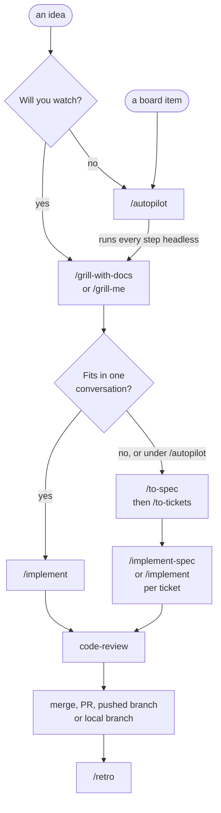

# The Claude workflow

From an idea to merged work, one skill per step, with you at the keyboard or
with `/autopilot` running it alone. In a shell, `cc-flow` prints this page as a
short table.

## Once per repo

Run `/setup-dan-skills` once in each repo. It asks up to eight questions and
saves the answers, so the other skills never ask again. Every repo gets five:
whether the repo is shared with a team, the tracker (GitHub, Shortcut or Jira),
where specs and tickets go, the glossary path, and the ADR folder. A GitHub
tracker adds three: whether agents open PRs, whether they merge their own, and
whether the repo ships releases.

In a shared repo the glossary and ADRs are committed for everyone, and the
tracker file stays in `~/.claude/repos/<repo>/`, out of the repo. GitHub is
offered only for a repo nobody else commits to. Its scripts set up the labels
and a board copied from a template board. A repo that ships releases gets
towncrier, which builds the changelog from one small file per PR and releases
through a PR. Any other repo gets no changelog.

## The flow

## Each step

1. **Grill.** `/grill-with-docs` asks numbered questions, each with its
   recommended answer, until nothing is open. It records terms in the glossary
   and big decisions as ADRs. Outside a repo, `/grill-me` runs the same
   interview and saves nothing.
2. **Prototype, when you must see it run.** Some questions only settle by
   running something: a state model, some logic, a screen. `prototype` builds
   throwaway variants and waits for you to pick one, and for a UI it briefs the
   screen with `impeccable` first. A small tweak runs in the planning
   conversation. A new screen runs in a fresh session: `/handoff` out,
   prototype there, then `/handoff` the verdict back.
3. **Plan.** A conversation means one context window. Past roughly 150k tokens
   the model reasons less sharply, so each ticket is sized to fit a fresh one.
   `/to-spec` writes where you are going: the problem, the solution, user
   stories, decisions, and what is out of scope. `/to-tickets` cuts it into
   thin slices, each with its blockers and its first failing test, grouped into
   the fewest PRs. Both save locally. With a GitHub tracker, one issue per PR
   goes on the board. With Shortcut or Jira, you get one ticket per PR on a
   page with Copy buttons when the work is done, and you file them. Keep steps
   1 to 3 in one conversation and clear it only after `/to-tickets`.
4. **Build.** `/implement` takes one ticket per fresh conversation, blockers
   first. `/implement-spec` builds the whole spec on one integration branch,
   with ready tickets in parallel. Every path writes the tests first (`tdd`).
5. **Review.** `code-review` checks the diff against your standards and
   against the spec, and reports the two apart. A UI change also gets
   `/impeccable audit`. Then you try it yourself, and anything you want changed
   becomes a new ticket.
6. **Ship.** `/pr` writes a paste-ready title and body.
7. **Learn.** `/retro`, in the same session before you clear it, suggests
   setup changes that would catch the same mistake next time, including a
   stale `PRODUCT.md` or `DESIGN.md`.

A small, clear change goes straight to `/implement`. A bug starts with
`diagnosing-bugs`. `/research` and `/improve-codebase-architecture` produce
findings that start the flow again at step 1.

## Autopilot

`/autopilot <idea>` takes free text as the idea, and `/autopilot board` takes
the next item on the tracker's board. It works one item per run and skips the
prototype step. Typing the command approves the run's subagents: about 10
build and research agents at most, plus up to 50 small voters.

> [!IMPORTANT]
> Start Claude in bypass or auto permission mode first. The run tests for a
> permission prompt before anything else and stops if it meets one.

Nobody answers its questions, so `grilling`'s confidence rule settles each one
from evidence or a vote of fresh agents. A question that is hard to undo, or
that the rule cannot settle, parks: the run stops and reports the question with
numbered options, on the board item when there is one. Every decision goes to
`.scratch/<feature>/decisions.md` in the main checkout.

It always writes a spec and tickets, and builds them with `/implement-spec` on
a branch named `autopilot-<feature>` in its own worktree. Then it goes as far
as the repo's switches allow:

1. Merge, when the tracker file says agents merge their own PRs and both
   switches are on.
2. An open PR, when `claude.allowPush` and `claude.allowPrs` are both `true`.
3. A pushed branch, when only `claude.allowPush` is on. `cc-push` flips it.
4. The local branch, with a recap page, otherwise.

Last, it runs `/retro` and puts the suggestions in its report without applying
any.
